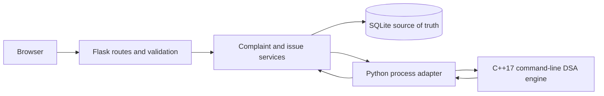

# Architecture

Flask receives form/query data, validates bounded fields, then uses bound SQL parameters through SQLite. For candidate scans, Python serializes records as UTF-8 tab-separated lines: first line `duplicates`; following lines contain complaint ID, category, locality, location description, description. Tabs/newlines in fields are replaced with spaces. C++ normalizes English alphanumeric text, filters category+locality, computes Levenshtein similarity, and emits a tab-separated header and candidate rows. Python parses and validates row shape, maps public IDs to SQLite integer keys, then stores suggestions. Score calls use `score` then `severity affected age_days`, returning one numeric line. Algorithm calls have a ten-second timeout; the controlled benchmark has a sixty-second timeout. Missing executable and invalid output produce explicit errors.

Example scan input: `duplicates\nCR000101\tPothole\tKothrud\tKarve Road\tlarge pothole near junction\nCR000102\tPothole\tKothrud\tKarve Road\tpothole by junction\n`. The engine returns a header and, when the combined score passes threshold, a row shaped like `CR000101\tCR000102\t<description-similarity>\t<location-similarity>\t<combined-score>`. Python checks the row shape and numeric ranges, maps the public IDs to DB row keys, stores a pending candidate, and sets `location_match` when location similarity is at least 0.5. Confirmation is a separate POST and the only step that creates issue links.

Confirming a pair starts `BEGIN IMMEDIATE`; group creation/linking, aggregate recalculation and candidate review are one commit or rollback. Rejected pairs change only review status. Templates escape user text by default. Status updates write the complaint and audit row together. The demo server is unauthenticated and local only.
