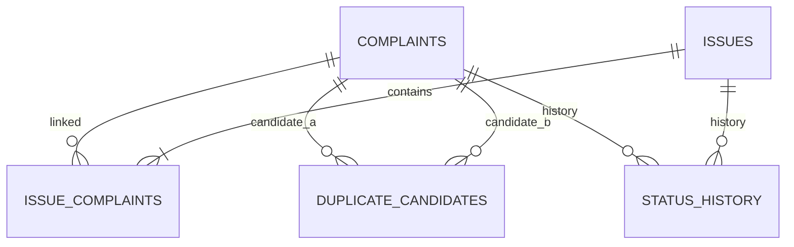

# Database design

SQLite file: `data/civicresolve.db`; every connection enables foreign keys. Schema creation is idempotent.

| Table | Purpose and key constraints |
|---|---|
| complaints | Integer PK; unique human ID; category, text, locality, landmark, severity 1–5, nonnegative impact, timestamps, status check, optional pseudonymous reference and demo flag. |
| issues | Integer PK; unique issue ID; category/locality/landmark/summary, severity, impact, priority, checked status and timestamps. |
| issue_complaints | Composite `(issue_id,complaint_id)` PK; both FKs; complaint_id also UNIQUE so one active group per complaint; actor/reason/timestamp. |
| duplicate_candidates | Integer PK; ordered pair check `a<b`, unique pair, FK references, bounded scores, review state check and review timestamps/reason. |
| status_history | Integer PK; optional complaint and issue FKs; check exactly one target is non-null; old/new status, actor, time and note. |
| locations | Integer PK; unique locality label; optional coordinates left null; demo-location flag. |

Indexes cover complaint category/locality/status/reported date, issue status/priority, candidate review status and issue links. Unique constraints and primary keys provide their own indexes; no duplicate ID index is added. The grouped issue's severity is the maximum linked report severity and its estimated affected population is the maximum report estimate, avoiding additive double counting. Status history stores transitions; statuses are restricted to the three allowed values, with no transition graph imposed in this prototype. All multi-row duplicate confirmations use a transaction and reject groups that would join two different existing issues.

